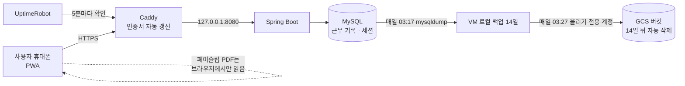

# 워홀 88 — 세컨·서드 비자 근무 일수 카운터

호주 워킹홀리데이 메이커가 세컨 비자(88일)·서드 비자(179일)에 필요한 **인정 근무 일수**를 쉽게 세도록 돕는 모바일 웹앱입니다.
호주에서 2년 넘게 워홀을 하며 직접 겪은 "이 근무가 며칠로 인정되지?"라는 문제를 풀려고 만들었습니다.

- 서비스: https://whv88.duckdns.org (구글 로그인, 무료)
- 출시: 2026-11-11 · 출시 이틀 동안 **가입 22명** (워홀 커뮤니티 공유)
- 운영 비용: 월 **0원** (GCP 무료 등급)

> 법률·이민 자문이 아니며, 최종 판단은 호주 내무부(Home Affairs) 공식 안내를 확인해야 합니다.

---

## 주요 기능

| 기능 | 설명 |
|---|---|
| 근무 기록 · 인정 일수 | 날짜별로 여러 일터 근무를 넣으면 규정대로 인정 일수를 계산합니다. 하루에 두 곳 일해도 1일, 주 5일 = 7일 인정, 평소 시간보다 짧게 일한 날은 따로 표시합니다. |
| 인정 지역 확인 | 포스트코드와 업종으로 세컨 인정 지역·업무인지 확인합니다 (로그인 없이). 내무부 포스트코드 표 5,765행을 기준으로 합니다. |
| 페이슬립 읽기 | 페이슬립 PDF에서 고용주·ABN·기간·근무 시간을 자동으로 채웁니다. **PDF는 브라우저에서만 읽고 서버로 보내지 않습니다** (TFN·계좌번호 보호). |
| 증빙 PDF | 비자 신청 때 참고할 근무 요약 PDF(영문, A4)를 만듭니다. |
| 페이스 계산 | 비자 만료일을 넣으면 "6월 24일까지 끝내려면 주 4일 출근"처럼 일주일에 몇 번 출근해야 하는지 알려줍니다. 기간 안에 불가능하면 그렇게 알려줍니다. 세컨·서드 모두 지원합니다. |

편의 기능: 홈 원탭 기록("오늘 ○○농장 8시간 일했어요"), 지난주 그대로 복사, 삭제 되돌리기, 로그인 30일 유지, 처음 온 사람 3단계 안내, 홈 화면에 추가(PWA).

## 기술 스택

- **Backend:** Java 17, Spring Boot 3.5, Spring Security (OAuth2 Google 로그인, CSRF), Spring Data JPA, Spring Session JDBC
- **DB:** MySQL 8.4 (운영), H2 (테스트·데모), Flyway 마이그레이션 V1~V10
- **Frontend:** Thymeleaf 서버 렌더링, 순수 JavaScript, pdf.js (브라우저 PDF 읽기), PWA
- **PDF 생성:** OpenPDF + 나눔고딕 임베드
- **Infra:** GCP Compute Engine e2-micro (Ubuntu), Caddy (HTTPS 자동 인증서), systemd, DuckDNS, Google Cloud Storage (백업)
- **운영:** GoatCounter (쿠키 없는 방문 통계), UptimeRobot (장애 알림), 관리자 통계 화면

## 구조



```
src/main/java/com/whv/tracker
├─ calc/         인정 일수·페이스 계산 (순수 함수, 스프링 의존 없음)
├─ eligibility/  포스트코드·업종 인정 판정
├─ ledger/       일터·근무 기록 (WorkRecord, WorkDay) 저장 규칙
├─ payslip/      페이슬립 기록 (원본 없이 읽은 값만)
├─ export/       증빙 PDF
├─ user/         계정, 탈퇴(전체 삭제)
├─ admin/        운영 통계 (/admin, 숫자만)
├─ security/     OAuth2 로그인, 보안 설정
└─ web/          컨트롤러
```

## 해결한 문제들 (운영하며 만난 실제 이슈)

**1. 탈퇴 요청 Deadlock** — [노트](docs/notes/FIX-account-delete-deadlock.md)
운영 로그에서 `Deadlock found when trying to get lock`을 발견했습니다. 같은 계정의 탈퇴 요청이 동시에 두 번 들어오면서(버튼 연타), 두 트랜잭션이 자식 테이블들을 서로 다른 순간에 잠갔습니다. 지우기 전에 계정 행을 `PESSIMISTIC_WRITE`(SELECT … FOR UPDATE)로 먼저 잠가 순서를 하나로 만들었고, 두 번째 요청은 조용히 끝나게 했습니다. 화면에서도 버튼 연타를 막고, 동시 탈퇴 테스트를 추가했습니다.

**2. 배포할 때마다 전원 로그아웃** — [노트](docs/notes/CONVENIENCE.md)
메모리 세션이라 재시작하면 모든 사용자가 다시 로그인해야 했습니다. Spring Session JDBC로 세션을 MySQL에 옮겼습니다. 그러자 `Cannot create a session after the response has been committed` 오류가 났습니다. Spring Security 6가 CSRF 토큰을 화면 출력 도중에 늦게 만들면서 세션을 새로 만들려 했기 때문입니다. 컨트롤러 단계에서 토큰을 미리 읽도록(`CsrfEagerAdvice`) 고쳤습니다.

**3. 회사마다 다른 페이슬립 형식** — [노트](docs/notes/F3.md)
실제 페이슬립 4종으로 시험해 보니, pdf.js가 글자를 표 순서가 아닌 저장 순서로 돌려줘서 `Ordinary 549.94 18.75 29.3300 Hours`처럼 값이 섞였습니다. 위치에 기대지 않고 **값 사이의 관계(시간 × 시급 = 금액)**로 근무 시간을 찾고, 제목("Pay Period")에서 **가장 가까운 날짜**로 기간을 찾도록 바꿔 4종 모두 맞게 읽게 했습니다.

**4. 최소 권한 백업** — [노트](docs/notes/BACKUP.md)
백업 계정에 "올리기"만 허용했더니 `gcloud storage cp`가 403(`objects.get` 없음)으로 실패했습니다. 권한을 넓히는 대신, 읽기 권한이 필요 없는 Storage JSON API 직접 업로드로 바꿨습니다. 서버가 침해돼도 이 키로는 백업을 읽거나 지울 수 없습니다.

## 계산 규칙과 근거

- 근거는 호주 내무부(Home Affairs) Specified work 공식 페이지만 사용하고, URL과 조사일을 문서에 남깁니다 ([PRD](docs/PRD.md) 6절 근거 표).
- 같은 날 여러 곳 근무 → 1일. 주 5일 근무 → 7일 인정(×7/5). 고용주의 평소 하루 근무 시간을 채운 날만 확실한 1일로 세고, 짧은 날은 따로 표시합니다.
- 페이스: 필요 일수 N, 남은 날 R → 일주일 출근일 = ⌈N × 5 ÷ R⌉. N > R이면 "기간 안에 채우기 어려움".
- 경계값 테스트 케이스는 PRD 9절에 있습니다.

## 개인정보와 보안

- 구글 로그인만 사용하고, 비밀번호를 저장하지 않습니다.
- 회원은 본인 데이터만 조회·수정합니다 (모든 조회에 소유자 검사).
- 페이슬립 원본은 서버로 보내지 않습니다.
- 비밀값(OAuth 비밀, DB 비밀번호, 백업 키)은 코드·문서에 쓰지 않고 서버 환경변수와 root 전용 파일로만 받습니다.
- 탈퇴하면 계정과 모든 기록을 즉시 지웁니다. 백업 사본은 14일 안에 자동 삭제됩니다.
- 방문 통계는 쿠키 없는 GoatCounter를 씁니다. 관리자 화면은 숫자만 보여주고, 권한이 없으면 404를 돌려줍니다.

## 테스트

```
mvn test   # 106개 (계산 규칙, 인정 판정, 근무 저장 규칙, 화면, 보안, 동시 탈퇴)
```

## 로컬 실행 (데모 데이터, 로그인 없이)

```
mvn spring-boot:run -Dspring-boot.run.profiles=demo
# http://localhost:8080
```

## 문서

- [PRD (기획서)](docs/PRD.md) · [결정 기록](docs/decisions/) · [기능별 구현 노트](docs/notes/)
- 배포 스크립트: [deploy/](deploy/) (서버 설치, 업데이트, 백업)

## 만든 사람

Brandon · 백엔드 개발자 지망 · [GitHub](https://github.com/kddong991121)
